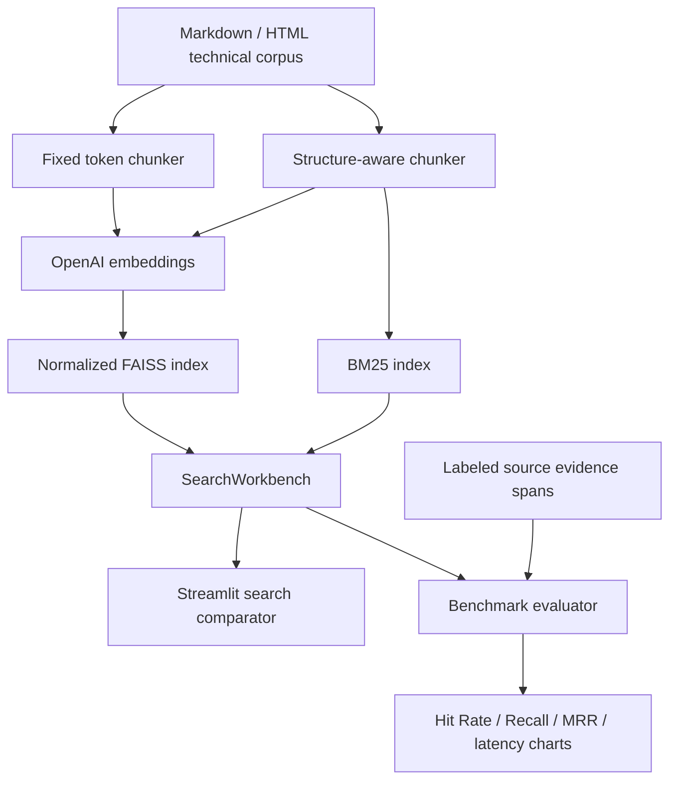

# Semantic Search Benchmarker

An interactive technical-document search engine comparing BM25 and OpenAI dense embeddings with FAISS. It measures retrieval quality and query latency for three chunking strategies.

## Architecture



## Setup

Requires Python 3.11, uv, internet access and an OpenAI API key with available API credits. Python packages include Pydantic v2, tiktoken, FAISS CPU, rank-bm25, OpenAI, Beautiful Soup, pandas and Streamlit.

```bash
uv python install 3.11
uv sync
cp .env.example .env
```

Put the real key in `.env` only. `.env.example` must retain its placeholder. The first tokenizer use may download the public tokenizer vocabulary. API calls for document and query embeddings are billable; no generative chat calls are made. Do not expose a paid API key through an unrestricted public app.

## Corpus and evaluation dataset

`corpus/api_spec_sample.md` contains 25 full NumPy 2.3.5 function docstrings (~13,645 whitespace-separated words, approximately 27 pages at 500 words per page, rather than physical PDF pages). The text is from the installed NumPy distribution, reorganized under Markdown headers, with the Examples subsections wrapped in four-backtick fences. The NumPy license is in `CORPUS_LICENSE.txt`. The corpus includes array manipulation, statistics, linear algebra, random generation, sorting and file I/O. HTML files may also be placed in `corpus/`; headings and preformatted code are converted to Markdown before indexing. Line and character offsets refer to this normalized text.

`data/eval_queries.json` contains 18 curated technical questions (8 exact identifier queries and 10 conceptual queries). Each label specifies a source file, semantic section title and unique source-text anchor. One question has two target spans. Labels are separate from indexed data. The benchmark resolves spans from the corpus, verifies they are covered in all chunking configurations, and evaluates retrieval without passing labels to the search engine.

| Configuration | Index | Chunking |
|---|---|---|
| BM25 baseline | BM25Okapi | Structural sections |
| Dense 256 | FAISS IndexFlatIP | 256 tokens, 32 overlap |
| Dense 1024 | FAISS IndexFlatIP | 1024 tokens, 32 overlap |
| Dense structural | FAISS IndexFlatIP | Header-based, fenced examples intact |

FAISS uses exhaustive inner-product search over normalized vectors (cosine similarity), not an approximate nearest-neighbor index. Fixed windows preserve original token overlap; UTF-8 safety may shorten individual windows slightly. Structural chunks vary in length. The same lowercase word tokenizer is used for both BM25 documents and queries. BM25 baseline uses the same structural units as dense structural, making that pair a direct method comparison.

## Metrics

- Hit Rate@K: average of 1 for a query with any labeled evidence in top K, or 0 for a miss.
- Recall@K: unique recovered target spans divided by total labeled spans, averaged over queries. Overlapping duplicates are not double-counted.
- MRR@K: average reciprocal first relevant rank, with zero for a miss within K.
- Average, p50 and p95 latency in milliseconds. Dense time includes API query embedding and local lookup. One measured embedding per query is shared across all three dense indexes; all metrics are computed using the same top-10 ranking sliced at K=3/5/10. Index construction is excluded. This small corpus is not a production-scale latency study.

## Run the application and tests

```bash
PYTHONPATH=. uv run streamlit run src/app.py
uv run pytest -v
RUN_LIVE_EMBEDDING_TEST=1 uv run pytest -v
```

The default suite has an offline deterministic dense-ranking fixture. The final command also runs a real OpenAI semantic-retrieval test (billable). To get actual benchmark results and populate the README automatically, run:

```bash
uv run python -m src.benchmarker --write-readme
```

This saves `data/benchmark_results.csv`, `data/benchmark_details.csv`, `data/benchmark_report.md`, and replaces the marked findings section below. Alternatively, run the benchmark in the UI and download its findings, then paste those results between the markers. Do not submit the placeholder instead of measured findings. The benchmark button uses real API calls; it does not substitute mock embeddings.

## Empirical benchmark findings

<!-- BENCHMARK_START -->

| Configuration | K | Chunks | Hit Rate | Recall | MRR | Average ms | p50 ms | p95 ms |
|---|---|---|---|---|---|---|---|---|
| BM25 baseline | 3 | 26 | 0.8889 | 0.8889 | 0.7685 | 0.26 | 0.26 | 0.38 |
| BM25 baseline | 5 | 26 | 0.9444 | 0.9444 | 0.7796 | 0.26 | 0.26 | 0.38 |
| BM25 baseline | 10 | 26 | 0.9444 | 0.9444 | 0.7796 | 0.26 | 0.26 | 0.38 |
| Dense 256 | 3 | 117 | 0.6111 | 0.6111 | 0.3519 | 284.25 | 245.15 | 600.34 |
| Dense 256 | 5 | 117 | 0.8333 | 0.8056 | 0.4046 | 284.25 | 245.15 | 600.34 |
| Dense 256 | 10 | 117 | 0.8889 | 0.8889 | 0.4102 | 284.25 | 245.15 | 600.34 |
| Dense 1024 | 3 | 27 | 0.8333 | 0.8333 | 0.6574 | 283.63 | 244.82 | 600.00 |
| Dense 1024 | 5 | 27 | 0.8889 | 0.8889 | 0.6713 | 283.63 | 244.82 | 600.00 |
| Dense 1024 | 10 | 27 | 1.0000 | 1.0000 | 0.6854 | 283.63 | 244.82 | 600.00 |
| Dense structural | 3 | 26 | 1.0000 | 1.0000 | 0.9722 | 283.60 | 244.81 | 599.98 |
| Dense structural | 5 | 26 | 1.0000 | 1.0000 | 0.9722 | 283.60 | 244.81 | 599.98 |
| Dense structural | 10 | 26 | 1.0000 | 1.0000 | 0.9722 | 283.60 | 244.81 | 599.98 |

On this run (18 labeled queries), the highest MRR@5 was 0.9722 for Dense structural. Dense 256, Dense 1024, and Dense structural achieved Hit Rate@5 of 0.8333, 0.8889, and 1.0000, respectively. Smaller windows can isolate exact evidence, larger windows retain more surrounding context, and structural sections keep examples together. These are plausible mechanisms rather than proof of causation; the labeled sample is small, and no one configuration should be assumed best for every workload.

The fastest average query at K=5 was BM25 baseline (0.26 ms). Dense latency includes the measured query embedding request plus local FAISS lookup; indexing time is excluded. The same single embedding request is shared across the three dense configurations for each query. BM25 executes locally. The trade-off between ranking quality, indexing overhead, and network latency should be validated on a larger held-out corpus before choosing a production retrieval strategy.

<!-- BENCHMARK_END -->

## AI audit summary

See `ai_prompt_log.md` and `audit/initial_draft.py`. The refactoring corrects BM25 query tokenization, distance/similarity ordering, stable ground-truth labels, Markdown code-fence handling and MRR top-K truncation. The test suite verifies each area. The fixed-size baseline can still split code blocks by design; the structural alternative preserves them.

## Deployment

For a local container demo, install Docker Desktop, configure `.env`, and run `docker compose up --build` from the project root. Open <http://localhost:8501>. Stop with Ctrl+C. The default port is bound to the local machine only. If another app uses 8501, stop it first. Alternatively, deploy the GitHub repository with Streamlit Community Cloud using `src/app.py` and a Python 3.11 environment; set `OPENAI_API_KEY` in the platform Secrets editor, not the repository. Restrict app access or use Docker to prevent other visitors from consuming your API credits. Cloud hosting itself may be free, but OpenAI API use is not.
